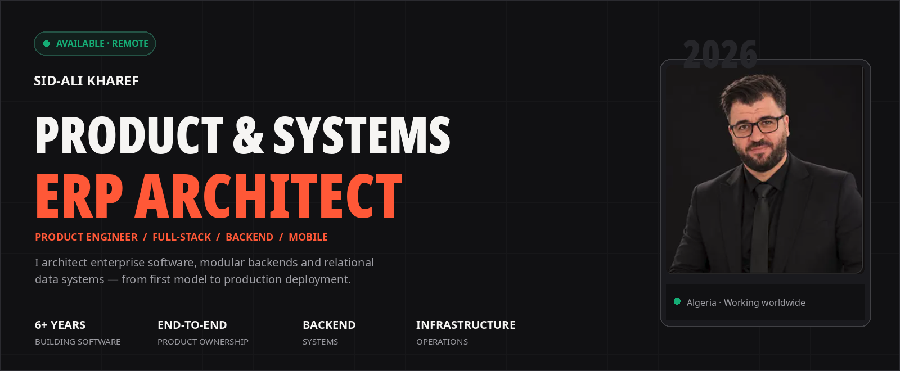
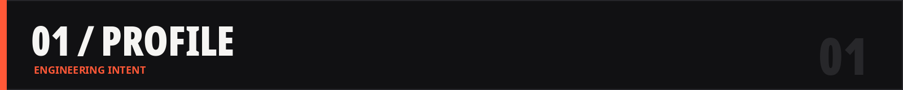
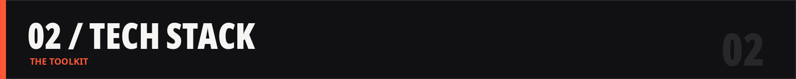
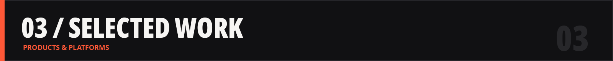
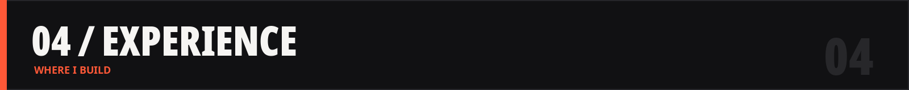
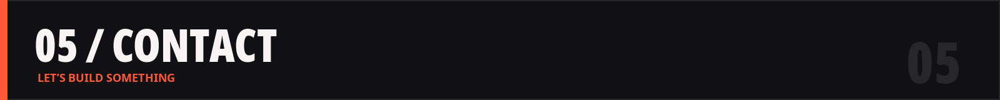

<!--
  SID-ALI KHAREF / GitHub Profile
  Designed to match https://sidalikharef.cc/
  GitHub README: black / off-white / orange (#ff5837).
  Keep the assets/ directory alongside this README.md.
-->

 

 

  

**PRODUCT & SYSTEMS ENGINEER** &nbsp; · &nbsp; **ERP & SOFTWARE ARCHITECT** &nbsp; · &nbsp; **FULL-STACK DEVELOPER**

*Building connected software systems — from business requirements and data architecture to deployment, automation, and production operations.*

 

I am **Sid-Ali Kharef**, a software engineer with **6+ years of experience** building web, mobile, backend and business software for international teams and clients.

I work across the full product lifecycle: requirements, architecture, schema design, APIs, interfaces, integrations, background processing, containerized delivery and maintenance. I specialize in software that supports actual business workflows, not isolated demos.

<table>
<tr>
<td width="50%" valign="top">

### `// CURRENTLY`

- **Software Engineer · Belsons Technologies** — enterprise ERP platform built with Django, Angular, PostgreSQL and Celery.
- **Co-Founder & Senior Full-Stack Engineer · VistroLink Group** — SaaS products, mobile apps, backend systems and automation.
- **Independent contractor** — remote delivery for international clients.

</td>
<td width="50%" valign="top">

### `// HOW I WORK`

- Design the data model and the business rules first.
- Keep API contracts explicit and authorization clear.
- Build dependable integrations with retries and observability.
- Own deployment, performance and ongoing maintenance.
- Choose maintainable tools over unnecessary complexity.

</td>
</tr>
</table>

### What I build

| Focus | Engineering capabilities |
| :--- | :--- |
| **Enterprise ERP / CRM** | Finance, operations, property, approvals, role-based workflows, dashboards, admin tools |
| **Backend & APIs** | REST APIs, auth, authorization, relational design, background jobs, integrations |
| **Web & SaaS** | Next.js/React apps, customer portals, admin dashboards, business workflows |
| **Mobile** | React Native/Expo, authentication, onboarding, media, storage, notifications |
| **Automation** | Inventory sync, CSV/SFTP pipelines, third-party services, scheduled processing |
| **Infrastructure** | Docker/Podman, CI/CD, Cloudflare, R2, S3-compatible storage, deployment |

 

**BACKEND & SYSTEM DESIGN**

**WEB, MOBILE & UI**

**DATA, DEVOPS & DELIVERY**

| Layer | Tools and technologies |
| :--- | :--- |
| **Backend** | Go, Python, Django REST Framework, Node.js, Express.js, AdonisJS |
| **Frontend** | TypeScript, React, Next.js, Angular, Tailwind CSS |
| **Mobile** | React Native, Expo |
| **Data** | PostgreSQL, Prisma ORM, MongoDB, SQLite, Redis |
| **Infrastructure** | Docker, Podman, Cloudflare, Cloudflare R2, S3-compatible object storage |
| **Build / Delivery** | Git, GitHub, GitLab CI/CD, Turborepo, pnpm workspaces |
| **Jobs / Integrations** | Celery, REST APIs, notifications, CSV/SFTP processing |
| **Commerce / CMS** | WordPress, WooCommerce, Strapi, PHP |

 

### `01` &nbsp; CarGrid / DealerLink — Automotive marketplace & dealer management

Multi-role vehicle marketplace systems featuring inventory, listings, valuations, media, saved vehicles and offer management for buyers, sellers and administrators.

`Next.js` `React Native` `Express.js` `Prisma` `PostgreSQL` `Cloudflare R2`

### `02` &nbsp; NovaBank / JiPay — Digital wallet & fintech MVP

Connected mobile and admin workflows for authentication, KYC onboarding, wallets, payment requests, QR/link payments, notifications and access control. **Stage: MVP.**

`React Native` `Expo` `Go` `Next.js` `PostgreSQL`

### `03` &nbsp; Nebula App — Accounting workflows & onboarding

Mobile onboarding, signup, OTP verification, business forms, API connectivity, validation and dashboard interfaces.

`React Native` `Expo` `Next.js` `TypeScript`

### `04` &nbsp; Automotive Inventory Automation

Inventory import and synchronization for WordPress/WooCommerce through CSV/SFTP feeds, batch jobs, attributes, media processing and AI-assisted vehicle descriptions.

`PHP` `WordPress` `WooCommerce` `SFTP` `REST APIs`

### `05` &nbsp; Open-source & personal engineering

Experiments and tools across remote-control software, CCTV/computer vision, image processing, developer utilities and self-hosted infrastructure.

**[Explore repositories](https://github.com/sidalikharef?tab=repositories)** · **[See portfolio case studies](https://sidalikharef.cc/)**

 

### <code>2026 → PRESENT</code> &nbsp; Belsons Technologies — Software Engineer

*Dubai, UAE · Remote · October 2026 – Present*

Enterprise ERP development across CRM, sales, finance, property management and operations. Backend services in Django/DRF, Angular/TypeScript features, PostgreSQL models, Celery tasks, testing, debugging and delivery.

**Core:** `Django` `DRF` `Angular` `PostgreSQL` `Celery` `Docker` `GitLab CI/CD`

### <code>2026 → PRESENT</code> &nbsp; VistroLink Group — Co-Founder & Senior Full-Stack Software Engineer

*Poland · Hybrid · May 2026 – Present*

Co-building SaaS platforms and client products. Product architecture, React/Next.js apps, React Native/Expo mobile applications, Go/Node.js APIs, authentication, data models, integrations, deployments and automation.

**Core:** `Next.js` `React Native` `Go` `Node.js` `Prisma` `Docker` `Cloudflare`

### <code>2019 → PRESENT</code> &nbsp; Independent Contractor — Full-Stack Developer & SaaS Engineer

*Algeria · Remote · October 2019 – Present*

End-to-end client delivery: requirements, architecture, SaaS, mobile features, admin portals, databases, role-based access, third-party integrations, inventory automation and production support.

**Core:** `React` `Next.js` `Node.js` `Go` `Expo` `PostgreSQL` `MongoDB` `Prisma`

### <code>2024 → 2026</code> &nbsp; The Web Is Mine — Full-Stack, Mobile & Backend Developer

*Algeria · Freelance · January 2024 – June 2026*

Automotive software, dashboards, mobile applications, Express.js backends, Prisma/PostgreSQL, authentication and two-factor flows, data import pipelines, cloud storage and Turborepo monorepos.

**Core:** `React Native` `Next.js` `Express.js` `Prisma` `Turborepo` `Cloudflare R2`

### <code>2022 → 2023</code> &nbsp; Studio rightup — Full-Stack Engineer

*Skikda, Algeria · Hybrid · September 2022 – September 2023*

Worked on modular CRM/ERP features: configurable business processes, backend APIs, integrations, frontend workflows, multi-tenant design, testing and maintenance. Received a professional recommendation from leadership.

**Core:** `React` `Next.js` `AdonisJS` `MongoDB` `KrakenD`

### Education

**Master 2 — Software Engineering & Project Management** · Completed November 2025.

 

### YOUR NEXT PRODUCT NEEDS MORE THAN A UI.

I can help with **architecture, backend systems, ERP workflows, full-stack applications, mobile products, integrations and deployment**.

  

**[sidalikharef.cc](https://sidalikharef.cc/)** &nbsp; / &nbsp; **[LinkedIn](https://www.linkedin.com/in/sid-ali-kharef-b5195419b/)** &nbsp; / &nbsp; **[GitHub](https://github.com/sidalikharef)** &nbsp; / &nbsp; **[Email](mailto:sidalikharef@gmail.com)**

DESIGNED TO MATCH THE SID-ALI KHAREF PORTFOLIO · 2026

