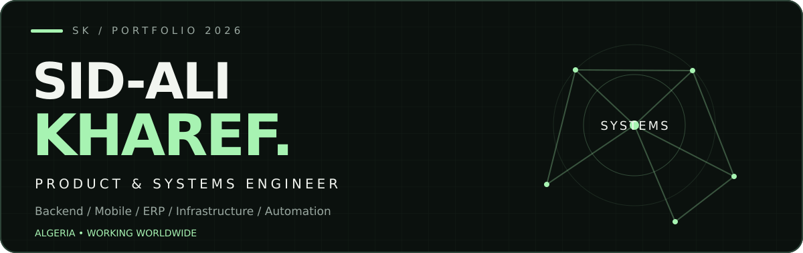
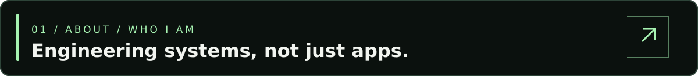
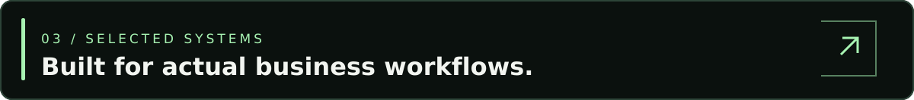
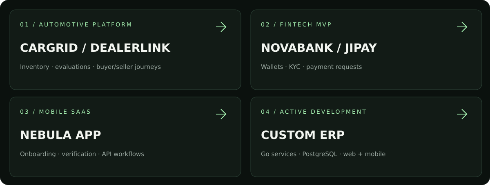
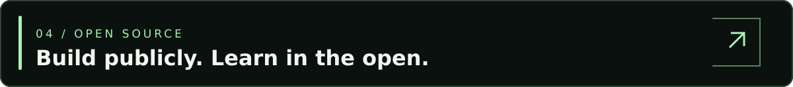
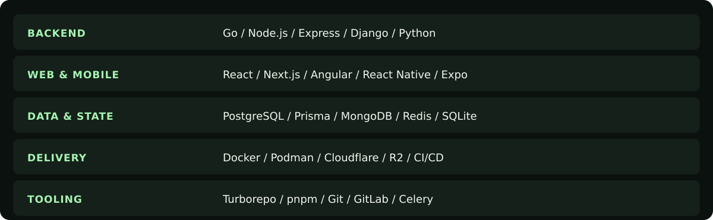

<!-- GitHub profile README | sidalikharef/sidalikharef -->
<!-- Original artwork in assets/ is local, so the main design does not rely on GitSkins or another image API. -->

<div align="center">
  <a href="https://sidalikharef.cc/"></a>
  <br/><br/>
  <a href="https://sidalikharef.cc/"></a>
  <a href="https://www.linkedin.com/in/sid-ali-kharef-b5195419b/"></a>
  <a href="mailto:sidalikharef@gmail.com"></a>
  <a href="https://github.com/sidalikharef?tab=repositories"></a>
  <br/><br/>
  <strong>6+ years engineering software &nbsp; / &nbsp; 10+ systems delivered &nbsp; / &nbsp; Remote worldwide</strong>
  <br/><br/>
  <sub>Frontend ↔ API ↔ Data ↔ Automation ↔ Infrastructure</sub>
</div>

<br/>

<a id="about"></a>


I am **Sid-Ali Kharef**, a software engineer based in **Algeria** working with international product teams. I design and ship connected software: backend APIs, web interfaces, mobile apps, operational dashboards, and the infrastructure behind them.

My focus is **systems thinking**: well-defined data models, clear security boundaries, maintainable integration layers, and end-to-end ownership from product requirements to production support.

- **Currently:** Software Engineer at **Belsons Technologies**; Co-Founder & Senior Full-Stack Software Engineer at **VistroLink Group**.
- **Background:** Independent contracting since 2019 across SaaS, automotive, fintech, CRM/ERP, commerce, and workflow automation.
- **Availability:** Open to remote engineering roles and selected consulting engagements.
- **Approach:** Solve the product problem, simplify the architecture, then ship and operate reliably.

<a id="capabilities"></a>


| Systems & APIs | Web & Mobile | Data & Operations |
|:---|:---|:---|
| Authentication, authorization and RBAC | React and Next.js applications | PostgreSQL schema design |
| Go, Node.js and Django services | React Native and Expo | Prisma and migration workflows |
| REST integrations and business logic | Internal portals and ERP dashboards | Background jobs and Celery |
| Multi-role and tenant-aware workflows | Accessible, responsive UI | CSV/SFTP synchronization |
| API contracts and testable boundaries | API-driven onboarding flows | Docker, storage, CI/CD and Cloudflare |

<a id="systems"></a>




<details open>
<summary><b>CarGrid / DealerLink — Automotive marketplace & dealer management</b></summary>
<br/>
Built web, mobile and backend workflows for inventory, vehicle listings, VIN-based valuation, media handling, saved listings, offers and role-specific buyer, seller, employee and administrator experiences.

**Engineering:** Next.js · React Native / Expo · Express.js · Prisma ORM · PostgreSQL · Cloudflare R2
</details>

<details open>
<summary><b>NovaBank / JiPay — Digital wallet & fintech MVP</b></summary>
<br/>
Designed interconnected mobile, API and administration workflows for account onboarding, KYC states, wallet operations, payment requests, QR/link payment flows, notifications and role-based access. **Status: MVP; not a claim of a live regulated banking product.**

**Engineering:** Go · React Native / Expo · Next.js · PostgreSQL
</details>

<details open>
<summary><b>Nebula App — Mobile SaaS onboarding</b></summary>
<br/>
Delivered authentication, verification, reusable form flows, validation, API-backed account workflows, and connected dashboard interfaces.

**Engineering:** React Native · Expo · Next.js · TypeScript
</details>

<details open>
<summary><b>Custom ERP Platform — Modular business system</b></summary>
<br/>
Architecting an ERP with shared web/mobile clients, domain-based API services, tenant-aware roles, relational data and OpenAPI contracts. Current implementation includes authentication plus selected read-only CRM and sales slices; broader finance/HR/workflow scope remains in development.

**Engineering:** Go / Gin · PostgreSQL · pgx / sqlc · Next.js · React Native / Expo · OpenAPI · pnpm workspaces · Docker Compose
</details>

<details>
<summary><b>Prêt Auto Québec — Automotive inventory automation</b></summary>
<br/>
Automated imports from seven external inventory sources using CSV/SFTP feeds, batch processing, WooCommerce product and attribute synchronization, media preparation, and AI-assisted vehicle descriptions.

**Engineering:** WordPress · WooCommerce · PHP · SFTP · external APIs
</details>

<details>
<summary><b>Xpertise360 — Headless learning content platform</b></summary>
<br/>
Implemented structured content models, Strapi-backed APIs, content routing and integration workflows for an online education and coaching platform.

**Engineering:** Next.js · Strapi · headless CMS · REST APIs
</details>

<details>
<summary><b>Other delivered client systems</b></summary>
<br/>

- **VR Secur+** — warranty information and lead capture workflows with Next.js / Express.
- **Dupont & Dupont** — structured bakery product catalog and backend management foundation.
- **Entretien Paysager Siana** — service intake and CRM-ready lead routing.
- **OrderCube** — WordPress/PHP production fixes across email, translations, SEO and custom logic.

</details>

**Full case studies, architecture notes and project galleries:** [sidalikharef.cc](https://sidalikharef.cc/)

<a id="opensource"></a>


| Repository | What it explores | Links |
|:---|:---|:---|
| **Sidali Vision** | Local-first computer vision: detection, tracking and annotated media workflows | [Repository](https://github.com/sidalikharef/Sidali-Vision) |
| **Sidali DitherLab** | Browser-based image dithering, palettes, comparisons and exports | [Repository](https://github.com/sidalikharef/js-image-dithering-converter-and-compression) · [Live demo](https://ditterlab.sidalikharef.cc/) |
| **GoRemote** | Desktop / networked remote-control and device workflows | [Repository](https://github.com/sidalikharef/goremote) |
| **Seeker** | Developer-focused open-source tooling | [Repository](https://github.com/sidalikharef/Seeker) |

> Open-source repositories are experiments and evolving tools; status and supported features are documented in their individual READMEs.

<a id="stack"></a>




<details>
<summary><b>Expand the full technical stack</b></summary>
<br/>

| Domain | Technologies and practices |
|:---|:---|
| **Backend** | Go, Gin, Node.js, Express.js, AdonisJS, Python, Django, Django REST Framework, REST APIs, RBAC |
| **Frontend** | TypeScript, JavaScript, React, Next.js, Angular, Tailwind CSS, TanStack Query, Zustand |
| **Mobile & desktop** | React Native, Expo, Electron, Tauri |
| **Database & cache** | PostgreSQL, Prisma ORM, pgx, sqlc, MongoDB, Redis, SQLite |
| **Architecture** | Modular services, typed contracts, monorepos, Turborepo, pnpm workspaces, API integrations |
| **Delivery** | Docker, Podman, Docker Compose, Cloudflare, Cloudflare R2, S3-compatible storage, GitHub, GitLab CI/CD |
| **Automation** | Celery, CSV/SFTP pipelines, background processing, notifications, image/media workflows |
| **Commerce & CMS** | WordPress, WooCommerce, Strapi, PHP |

</details>

<a id="experience"></a>


**Belsons Technologies** — Software Engineer  
`Oct 2026 – Present` · Dubai, UAE · Remote

Working on an enterprise ERP spanning CRM, sales, finance, property management and business operations. Developing Django REST APIs, Angular frontends, PostgreSQL models, Celery tasks, permissions and operational workflows.  
`Python` `Django` `DRF` `Angular` `PostgreSQL` `Celery` `Docker` `GitLab`

**VistroLink Group** — Co-Founder & Senior Full-Stack Software Engineer  
`May 2026 – Present` · Poland · Hybrid

Co-building custom software and SaaS products, from architecture and web/mobile implementation through APIs, authentication, database design, workflow automation, cloud integrations and deployment.  
`React` `Next.js` `TypeScript` `React Native` `Expo` `Go` `Node.js` `Prisma` `Docker`

**Independent Contractor** — Full-Stack Developer & SaaS Engineer  
`Oct 2019 – Present` · Algeria · Remote

End-to-end software delivery for international clients: requirements, SaaS platforms, APIs, dashboards, desktop/mobile features, data pipelines, troubleshooting and ongoing production support.  
`React` `Next.js` `Node.js` `Go` `Expo` `PostgreSQL` `MongoDB` `Prisma`

**The Web Is Mine** — Full-Stack, Mobile & Backend Developer  
`Jan 2024 – Jun 2026` · Algeria · Freelance

Automotive and business applications, 2FA, role-based access, Prisma/PostgreSQL schemas, R2 storage, integrations, monorepos and WooCommerce synchronization.  
`Next.js` `React Native` `Express` `Prisma` `Turborepo` `Cloudflare R2`

**Studio rightup** — Full-Stack Engineer  
`Sep 2022 – Sep 2023` · Skikda, Algeria · Hybrid

Modular CRM/ERP interfaces, configurable forms and business processes, backend APIs and third-party integrations, with a focus on multi-tenant product workflows.  
`React` `Next.js` `AdonisJS` `MongoDB` `KrakenD`

<a id="engineering"></a>


```text
             PRODUCT REQUIREMENTS
                      │
        ┌─────────────┼──────────────┐
        ▼             ▼              ▼
   WEB / MOBILE    API CONTRACTS   OPERATIONS
        │             │              │
        └──────────► DOMAIN ◄────────┘
                      │
                 DATA MODEL
                      │
              JOBS / INTEGRATIONS
                      │
              DEPLOY & OBSERVE
```

1. **Model the domain first.** Keep relational data, business rules, and service boundaries explicit.
2. **Secure the workflows.** Build authentication, authorization and tenant context into the design.
3. **Integrate for failure.** Make background jobs, external APIs and synchronization observable and retryable.
4. **Deliver end-to-end.** Treat deployment, testability, maintenance and developer experience as product responsibilities.

**Education:** Master 2 — Software Engineering & Project Management (completed November 2025).

<a id="connect"></a>


<div align="center">
  <h3>Have a product to ship or a system to improve?</h3>
  <p>I’m interested in remote product/systems engineering roles and selected consulting work.</p>
  <a href="https://sidalikharef.cc/">Portfolio</a> &nbsp;·&nbsp;
  <a href="https://www.linkedin.com/in/sid-ali-kharef-b5195419b/">LinkedIn</a> &nbsp;·&nbsp;
  <a href="mailto:sidalikharef@gmail.com">Email</a> &nbsp;·&nbsp;
  <a href="https://github.com/sidalikharef">GitHub</a>
  <br/><br/>
  <sub>© Sid-Ali Kharef · Based in Algeria · Working worldwide</sub>
</div>
